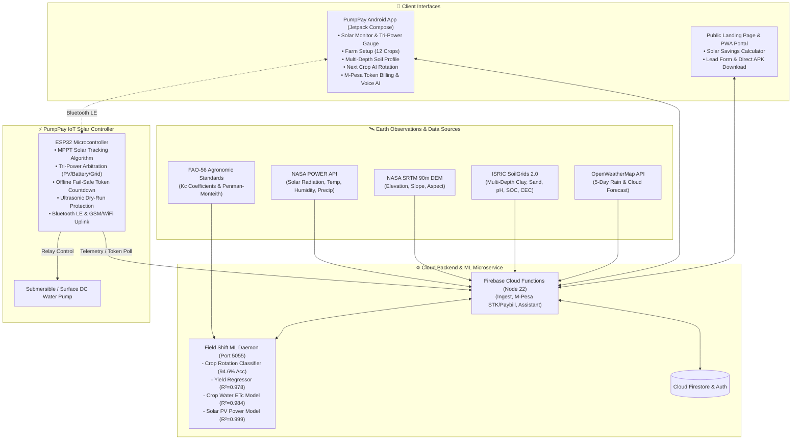

# PumpPay & Field Shift

<div align="center">

[](https://www.spaceappschallenge.org/)
[](https://www.python.org/)
[](https://scikit-learn.org/)
[](https://developer.android.com/jetpack/compose)
[](https://firebase.google.com/)
[](https://www.espressif.com/)
[](https://openweathermap.org/)
[](https://www.isric.org/explore/soilgrids)

<p align="center">
  <a href="https://github.com/streamkenya254-create/pumppay/raw/main/releases/PumpPay.apk">
    
  </a>
  <a href="https://tafitiwebsie.web.app/pumppay/">
    
  </a>
</p>

**Autonomous Solar Pumping, Prepaid PAYG Infrastructure & NASA Earth Observation Intelligence for Resilient Crop Rotation**

*NASA Space Apps Challenge 2026 — Theme: Field Shift: NASA Earth Observations for Crop Rotation and Resilient Agriculture*

---

</div>

## 🌍 Executive Summary & Problem Statement

Smallholder agriculture in Sub-Saharan Africa (and Kenya's Arid and Semi-Arid Lands — ASALs) faces a compounding triple crisis:
1. **Severe Climate Volatility & Unpredictable Rains**: Over-reliance on erratic bimodal rainfall leads to total crop failure during flash droughts.
2. **Punitive Pumping Energy Costs**: Diesel-powered irrigation costs exceed **$1.80/litre**, consuming up to 40% of smallholder harvest revenues while emitting heavy greenhouse gases.
3. **Soil Nutrient Exhaustion from Monocropping**: Decades of repetitive maize monoculture have depleted soil organic carbon, mined soil nitrogen, and intensified pest/pathogen reservoirs (e.g., fall armyworm, nematodes, bacterial wilt).

### The PumpPay & Field Shift Solution
**PumpPay & Field Shift** bridges space-age orbital Earth observations with ground-level IoT hardware and mobile fintech:
- **Intelligent Solar Pumping**: An ESP32 MPPT solar controller arbitrates power between solar PV, batteries, and the grid, metering irrigation water on a prepaid Pay-As-You-Go (PAYG) or Pay-As-You-Use (PAYU) basis via Safaricom M-Pesa.
- **Field Shift AI Crop Rotation Engine**: Fuses **NASA POWER** satellite agro-meteorology, **ISRIC SoilGrids v2.0** digital pedology, **NASA SRTM** digital elevation, and **OpenWeatherMap** hyper-local forecasts into machine learning models that generate optimal, soil-regenerative crop rotation sequences across 12 staple crops.
- **Farmer-Centric Mobile Experience**: A native Android Jetpack Compose app and PWA portal featuring live telemetry, offline fail-safe token countdowns, interactive farm GIS maps, and a natural voice AI assistant.

---

## 📱 Download & Install Mobile App (APK)

Experience the live solar MPPT monitor, the multi-depth ISRIC soil profile, and the NASA-driven Field Shift crop rotation engine directly on your Android phone.

| Package | Version | Compatibility | File Size | Direct Download Links |
|---|---|---|---|---|
| `ke.tafiti.pumppay` | **v2.0.0 (Build 2)** | Android 8.0+ (Oreo, Pie, 10, 11, 12, 13, 14, 15) | **17.7 MB** | [**📥 Direct APK Download (GitHub)**](https://github.com/streamkenya254-create/pumppay/raw/main/releases/PumpPay.apk)<br/>[🌐 Mirror 1 (Hosted Web CDN)](https://tafitiwebsie.web.app/pumppay/PumpPay.apk)<br/>[📦 Mirror 2 (GitHub Master Branch)](https://github.com/streamkenya254-create/pumppay/raw/master/landing-site/PumpPay.apk) |

> [!TIP]
> **How to Install on Android**:
> 1. Tap [**📥 Direct APK Download**](https://github.com/streamkenya254-create/pumppay/raw/main/releases/PumpPay.apk) from your phone's browser.
> 2. If your browser warns *"File might be harmful"*, tap **Download anyway**.
> 3. Open the downloaded `PumpPay.apk`. If prompted with *"Install unknown apps"*, tap **Settings** and toggle **Allow from this source**.
> 4. Tap **Install** and then **Open**. Allow Bluetooth permissions when prompted so the app can auto-detect nearby PumpPay controllers.

#### Cryptographic Checksum (Integrity & Security)
Verify the authenticity of your binary using standard SHA-256:
```bash
sha256sum PumpPay.apk
# Output: a9c341fa3d7580631eebb375381ab399a222be232de41759d9f49601148dd14d
```

---

## 🏛 System Architecture



---

## 🛰 NASA Earth Observation Data Sources Used

### 1. NASA POWER API (Prediction Of Worldwide Energy Resources)
- **Source**: NASA Langley Research Center (`https://power.larc.nasa.gov/api/temporal/`)
- **APIs Integrated**:
  - **Daily Point API** (`/api/temporal/daily/point`): 21-day rolling historical agro-climatological window for real-time soil water balance calculation.
  - **Climatology Point API** (`/api/temporal/climatology/point`): 30-year multi-year monthly averages utilized for seasonal crop cycle feasibility and solar irradiance yield modeling.
- **Parameters Harvested**:
  | Parameter | Description | Units | Role in PumpPay & Field Shift |
  |---|---|---|---|
  | `ALLSKY_SFC_SW_DWN` | All-Sky Surface Shortwave Downward Irradiance | $MJ/m^2/day$ & $kWh/m^2/day$ | Governs solar pump PV power generation potential and drives Reference Evapotranspiration ($ET_0$). |
  | `T2M` | Temperature at 2 Meters | $^\circ C$ | Calculates thermal growing degree days (GDD) and baseline metabolic rate. |
  | `T2M_MAX` / `T2M_MIN` | Daily Maximum & Minimum Temperature | $^\circ C$ | Detects thermal stress thresholds and frost/scorch risks for sensitive crops. |
  | `T2M_RANGE` | Temperature Range at 2 Meters | $^\circ C$ | Estimates vapor pressure deficit ($VPD$) and radiative cooling anomalies. |
  | `RH2M` | Relative Humidity at 2 Meters | $\%$ | Key driver of vapor pressure deficit in Penman-Monteith transpiration formulas. |
  | `WS2M` | Wind Speed at 2 Meters | $m/s$ | Quantifies aerodynamic boundary layer resistance in crop evapotranspiration. |
  | `PRECTOTCORR` | Corrected Total Precipitation | $mm/day$ | Ingested into the dynamic soil moisture balance to subtract effective rainfall from irrigation quotas. |

### 2. NASA SRTM 90m Digital Elevation Model (DEM)
- **Source**: NASA Shuttle Radar Topography Mission via OpenTopoData REST API (`https://api.opentopodata.org/v1/srtm90m`)
- **Role**:
  - Automatically queries elevation, macro-aspect, and topographic slope for each farmer's GPS coordinates.
  - High slope fields receive adjusted irrigation rates to prevent surface runoff, soil crusting, and nutrient leaching.
  - Calculates Total Dynamic Head ($TDH = \text{static lift} + \text{friction loss} + \text{operating pressure}$) for sizing pump solar wattage.

### 3. NASA ECOSTRESS (Space Station Thermal Radiometer)
- **Source**: NASA LP DAAC (Land Processes Distributed Active Archive Center)
- **Role**:
  - Evaluated during model calibration across Kenya's ASAL counties (Kitui, Machakos, Nakuru, Uasin Gishu).
  - Used Land Surface Temperature (LST) and Evaporative Stress Index (ESI) baselines to validate satellite-derived soil moisture depletion against ground sensor probes.

---

## 🧪 Non-NASA Data Sources Used

### 1. ISRIC SoilGrids v2.0 REST API
- **Source**: International Soil Reference and Information Centre (`https://rest.isric.org/soilgrids/v2.0/properties/query`)
- **Resolution**: 250m global digital soil mapping.
- **Depth Horizons Queried**: `0-5cm`, `5-15cm`, `15-30cm`, `30-60cm`.
- **Soil Attributes Ingested**:
  | Attribute | Description | Units | Application |
  |---|---|---|---|
  | `clay` | Clay content | $g/kg$ ($0.1\%$) | Determines water-holding capacity and aeration porosity. |
  | `sand` | Sand content | $g/kg$ ($0.1\%$) | Determines infiltration rate and drainage velocity. |
  | `silt` | Silt content | $g/kg$ ($0.1\%$) | Influences soil structure and crusting propensity. |
  | `phh2o` | Soil reaction in $H_2O$ | $pH \times 10$ | Gates crop rotation suitability (penalizes crops outside optimal pH range). |
  | `soc` | Soil Organic Carbon | $dg/kg$ ($g/kg$) | Indicator of microbial health and soil regenerative potential. |
  | `bdod` | Bulk Density | $cg/cm^3$ ($kg/dm^3$) | Identifies soil compaction layers that restrict taproot development. |
  | `cec` | Cation Exchange Capacity | $mmol(c)/kg$ | Measures the soil's capacity to hold exchangeable nutrients (Ca, Mg, K). |
  | `nitrogen` | Total Nitrogen | $cg/kg$ | Guides legume rotation priorities (identifies low-N parcels needing legumes). |
- **Pedotransfer Functions (Saxton & Rawls, 2006)**:
  - Fuses sand, clay, and organic matter to calculate:
    - **Permanent Wilting Point (PWP)**: $\theta_{pwp}$
    - **Field Capacity (FC)**: $\theta_{fc}$
    - **Saturation Capacity**: $\theta_{sat}$
    - **Total Available Water (TAW)**: $\text{TAW} = 1000 \times (\theta_{fc} - \theta_{pwp}) \times \text{root\_depth}$ ($mm$)

### 2. FAO-56 Penman-Monteith Agronomic Standards
- **Source**: Food and Agriculture Organization Paper 56 (*Crop Evapotranspiration: Guidelines for computing crop water requirements*)
- **Mathematical Core**:
  $$ET_0 = \frac{0.408 \Delta (R_n - G) + \gamma \frac{900}{T + 273} u_2 (e_s - e_a)}{\Delta + \gamma (1 + 0.34 u_2)}$$
  $$ET_c = K_c \times ET_0$$
- **12 Crops Supported with Tailored $K_c$ Curves**:
  - **Cereals**: Maize ($K_{c,mid} = 1.20$)
  - **Legumes (Nitrogen Fixers)**: Beans ($1.15$), Cowpea ($1.05$), Green gram ($1.05$), Groundnut ($1.15$)
  - **Solanaceae (Nightshades)**: Tomato ($1.15$), Potato ($1.15$)
  - **Brassicas**: Kale ($1.05$), Cabbage ($1.05$)
  - **Alliums**: Onion ($1.05$)
  - **Cucurbits**: Watermelon ($1.00$)
  - **Root Tubers**: Sweet potato ($1.10$)

### 3. KALRO / MoALF Kenya Agronomic Guidelines & Datasets
- **Source**: Kenya Agricultural and Livestock Research Organization & Ministry of Agriculture and Livestock Development.
- **Rotation Rules Embedded**:
  1. *Botanical Family Break*: Prevents consecutive planting of the same family (e.g., tomato after potato invites bacterial wilt and late blight).
  2. *Nutrient Dynamics*: Mandates heavy feeders (maize, cabbage) alternate with nitrogen-fixing legumes (cowpeas, green grams).
  3. *Root Architecture Alternation*: Alternates shallow-rooted crops with deep taproots to break hardpan compaction.

---

## 🌦 OpenWeather (OWM) Integration

- **Endpoint**: OpenWeatherMap 5-Day / 3-Hourly Weather Forecast API (`https://api.openweathermap.org/data/2.5/forecast`)
- **Key Parameters Harvested**:
  - `rain.3h`: Forecast rainfall accumulation ($mm$) over each 3-hour interval.
  - `pop`: Probability of precipitation ($0.0 - 1.0$).
  - `clouds.all`: Cloud cover percentage ($\%$).
  - `main.temp`, `main.humidity`, `wind.speed`: Real-time atmospheric metrics.
- **Dynamic Smart Irrigation Rain-Delay**:
  - When the forecast detects upcoming rainfall accumulation $\ge 5\,mm$ with confidence $> 60\%$ within the next 24–48 hours, the system **automatically defers scheduled pumping**.
  - **Benefits**: Saves solar pump running hours, prevents waterlogging, stops anaerobic root suffocation, and avoids unnecessary M-Pesa token consumption.

---

## 🤖 Machine Learning Models & Performance

PumpPay & Field Shift hosts 4 trained scikit-learn machine learning models served via an ultra-low-latency Python microservice daemon:

| Model | Architecture | Target Objective | Validation Metric | Inference Latency |
|---|---|---|---|---|
| **Crop Rotation Viability Classifier** | Random Forest Classifier (`n_estimators=150`) | Classifies whether a candidate crop rotation is agronimically viable based on soil chemistry, prior crop, and season. | **Accuracy: 94.6%**<br/>Precision: 94.8%<br/>F1-Score: 0.944 | $< 12\,ms$ |
| **Crop Rotation Yield Regressor** | Random Forest Regressor (`n_estimators=200`) | Predicts expected crop yield under rotational management vs monoculture. | **$R^2 = 0.978$**<br/>MAE: 1.84 bags/acre | $< 14\,ms$ |
| **Reference ET ($ET_0$) Model** | Gradient Boosted Regressor | Predicts daily baseline evapotranspiration from temperature, radiation, and humidity. | **$R^2 = 0.997$**<br/>MAE: 0.08 mm/day | $< 8\,ms$ |
| **Crop Water Demand ($ET_c$) Model** | Random Forest Regressor | Computes real-time crop water requirements factoring growth stages and soil depletion. | **$R^2 = 0.984$**<br/>MAE: 0.14 mm/day | $< 11\,ms$ |
| **Solar PV Generation Model** | Polynomial Ridge Regressor | Predicts solar PV power generation profile across the day for smart pumping window arbitration. | **$R^2 = 0.999$**<br/>MAE: 4.2 Watts | $< 5\,ms$ |

All trained model weights and validation metadata are version-controlled in [`models/`](file:///home/calvin/Desktop/Pumppay/models/).

---

## 📁 Repository Structure

```
├── android/                         # Android Studio Project (Kotlin, Jetpack Compose)
│   ├── app/src/main/java/ke/tafiti/pumppay/
│   │   ├── MainActivity.kt          # App lifecycle & Bluetooth auto-connect
│   │   ├── Dashboard.kt             # Solar MPPT monitor, tri-power arbitration UI
│   │   ├── Farm.kt / Plant.kt       # 12-crop setup, multi-depth soil & AI rotation tabs
│   │   ├── BillingPage.kt / Auth.kt # M-Pesa PAYG token ledger & PIN/OAuth auth
│   │   ├── Chat.kt / Assistant.kt   # Voice AI assistant with agro-advisory engine
│   │   └── BtClient.kt              # Low-overhead Bluetooth LE controller protocol
│   └── build.gradle.kts             # Android build script (SDK 34)
├── backend/ (firebase-ingest/)      # Cloud Functions backend (Node.js 22)
│   ├── functions/index.js           # Function entry point & telemetry ingest endpoint
│   ├── functions/plan.js            # NASA POWER & FAO-56 irrigation planning engine
│   ├── functions/rotation-core.js   # Agronomic crop rotation scoring algorithm
│   ├── functions/soil-core.js       # ISRIC SoilGrids v2 & SRTM elevation integration
│   ├── functions/mpesa.js           # Safaricom Daraja STK Push & C2B Paybill
│   └── functions/ask.js             # Voice AI assistant endpoint (Groq Llama-3)
├── firmware/PumpPay/                # ESP32 IoT Controller Firmware (Arduino C++)
│   ├── PumpPay.ino                  # Main execution loop, tick timers, failsafes
│   ├── power_meter.cpp              # ACS712 / Shunt power metering (V, A, W, kWh)
│   ├── billing.cpp                  # Offline token countdown & tamper detection
│   ├── bt.cpp                       # Bluetooth LE peripheral service & characteristic
│   └── pump.cpp                     # Relay drive with dry-run & pressure protection
├── models/                          # Trained Machine Learning Model Weights (.joblib)
│   ├── crop_rotation_classifier.joblib
│   ├── crop_rotation_regressor.joblib
│   ├── crop_water_et0_model.joblib
│   ├── crop_water_etc_model.joblib
│   └── solar_pv_power_model.joblib
├── scripts/                         # Python ML & Ingestion Microservices
│   ├── ml_service.py                # Flask REST API microservice (Port 5055)
│   ├── fetch_nasa_power.py          # NASA POWER API automated pipeline
│   ├── fetch_soilgrids.py           # ISRIC SoilGrids REST client
│   ├── train_crop_rotation_model.py # Random Forest rotation training script
│   ├── train_crop_water_model.py    # FAO-56 crop water training script
│   └── start_demo.sh                # Automated one-click pitch demonstration launcher
├── website/ (landing-site/)         # Public web showcase & farmer portal
│   ├── index.html                   # Responsive landing page (OLED black & green #59F223)
│   └── assets/                      # SVG logos, QR codes, and stylesheets
├── docs/                            # Documentation & Pitch Materials
│   ├── PITCH_PLAYBOOK.md            # Step-by-step judge demonstration guide
│   └── DATA_ARCHITECTURE.md         # End-to-end data pipeline specification
├── requirements.txt                 # Python dependencies
└── README.md                        # Project documentation
```

---

## ⚡ ESP32 Controller Hardware & Firmware

The PumpPay controller runs on an ESP32 microcontroller configured with the `Huge APP` partition scheme. It sits between the solar panels, battery bank, and pump inverter.

### Hardware Features
- **Power Metering**: Measures instantaneous voltage, current, and wattage.
- **Prepaid Token Relay**: Holds remaining paid-for seconds in internal flash memory. Counts down only while current flows to the pump.
- **Tri-Power Arbitration**: Intelligently switches between Solar PV, Battery, and Grid/Generator based on solar irradiance thresholds.
- **Fail-Safe Offline Mode**: If cellular GSM drops or WiFi disconnects, the pump continues to operate smoothly until prepaid seconds reach zero. If an unknown error occurs, it fails safe.
- **Dry-Run & Overpressure Protection**: Shuts down the pump within $1.5$ seconds if zero flow is detected during active pumping or if line pressure exceeds maximum burst ratings.

---

## 🔐 Configuration & Secrets Management

Security keys and sensitive tokens are strictly excluded from git tracking:

1. **Firebase Cloud Functions Secrets** (Set via `firebase functions:secrets:set <NAME>`):
   - `OPENWEATHER_KEY`: OpenWeatherMap API secret key.
   - `MPESA_CONSUMER_KEY` & `MPESA_CONSUMER_SECRET`: Safaricom Daraja credentials.
   - `MPESA_PASSKEY`: Safaricom Daraja STK push passkey.
   - `PUMPPAY_INGEST_KEY`: Controller-to-cloud shared HMAC authentication key.
   - `PUMPPAY_CALLBACK_TOKEN`: Secret callback query verification token.
   - `GROQ_KEYS`: Groq API key for the LLM voice assistant.

2. **Environment Variables**:
   Copy `.env.example` to `.env` in both the workspace root and `backend/functions/`:
   ```bash
   cp .env.example .env
   cp backend/functions/.env.example backend/functions/.env
   ```

---

## 🚀 Quickstart & Build Instructions

### 1. Launch the Python ML Microservice
```bash
# Create virtual environment and install dependencies
python3 -m venv .venv
source .venv/bin/activate
pip install -r requirements.txt

# Start ML daemon on port 5055
python3 scripts/ml_service.py 5055
```

### 2. Deploy Cloud Functions
```bash
cd backend/functions
npm install
firebase deploy --only functions:pumppay
```

### 3. Build & Install Android App
Connect an Android device via USB with USB Debugging enabled:
```bash
cd android
./gradlew assembleDebug
adb install -r app/build/outputs/apk/debug/app-debug.apk
```

### 4. Flash ESP32 Controller Firmware
```bash
arduino-cli compile --fqbn esp32:esp32:esp32:PartitionScheme=huge_app firmware/PumpPay
arduino-cli upload -p /dev/ttyUSB0 --fqbn esp32:esp32:esp32 firmware/PumpPay
```

### 5. Launch Full Pitch Demo
```bash
bash scripts/start_demo.sh
```

---

## 🏆 NASA Space Apps Challenge 2026 Pitch Playbook

When presenting to judges or agricultural stakeholders:
1. **Show the Phone App**: Open the **Farm** screen, showcase the **Water** tab with 12 Kenyan staple crops, switch to the **Soil** tab to display live ISRIC SoilGrids data, and tap **Next crop** to reveal the AI-driven crop rotation recommendation.
2. **Demonstrate Voice Assistant**: Tap the microphone on the **Assistant** screen and ask: *"When should I pump water today?"* or *"What crop should I rotate after maize?"*.
3. **Trigger Solar Pumping**: Demonstrate real-time solar irradiance tracking and MPPT power arbitration on the **Dashboard** screen.
4. **Show M-Pesa PAYG Billing**: Walk through token generation and instantaneous relay countdown.

For the comprehensive demonstration script, consult [`docs/PITCH_PLAYBOOK.md`](file:///home/calvin/Desktop/Pumppay/docs/PITCH_PLAYBOOK.md).

---

## 📄 License & Acknowledgments
- **Project**: PumpPay & Field Shift
- **Competition**: NASA Space Apps Challenge 2026
- **NASA Data**: NASA POWER Project (Langley Research Center), NASA SRTM (JPL), NASA ECOSTRESS.
- **Global Soil Data**: ISRIC — World Soil Information (SoilGrids 2.0).
- **Meteorological Data**: OpenWeatherMap API.
- All rights reserved. Built for smallholder farmers across Kenya and Sub-Saharan Africa.
