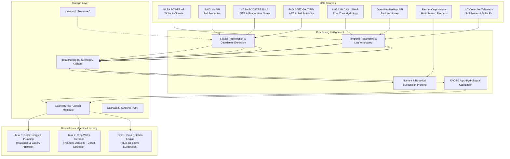

# Data Architecture & Pipeline Strategy

This document details the data architecture, spatial-temporal alignment strategies, and feature engineering workflows for the **Kenya Agricultural Intelligence and Water Management Platform**.

---

## 1. End-to-End Architectural Pipeline



---

## 2. Spatial-Temporal Alignment Strategy

### A. Coordinate Reference System (CRS)
- **Standard Projection**: All raster datasets (ECOSTRESS, GAEZ, Sentinel-2, SRTM) are normalized or reprojected to **WGS84 (EPSG:4326)** for coordinate queries and **UTM Zone 36N/37N (EPSG:32636 / EPSG:32637)** when calculating exact parcel area and perimeter distances in meters.
- **Bounding Box for Kenya Focus**:
  - Minimum Longitude: `33.9° E`
  - Maximum Longitude: `41.9° E`
  - Minimum Latitude: `-4.7° S`
  - Maximum Latitude: `5.5° N`

### B. Spatial Resolution Matching
- **Macro Climate & Radiation**: NASA POWER Daily ($0.5^\circ \times 0.5^\circ$, approx. 50 km) is spatially sampled at exact farm coordinates via bilinear interpolation across surrounding grid cells.
- **Hydrological Baseline**: GLDAS Noah ($0.25^\circ \times 0.25^\circ$) and SMAP ($9\text{ km} - 36\text{ km}$) sampled at parcel centroids.
- **Topography & Soil**: GAEZ ($5\text{ arc-minute}$, approx. 9 km) and SoilGrids ($250\text{ m}$) provide static physical constraints.
- **Thermal Water Stress**: ECOSTRESS L2 LSTE ($70\text{ m}$) provides field-scale crop canopy temperature resolution.

### C. Temporal Resampling & Alignment
- **Historical Climate Time Series**: NASA POWER observations are indexed on daily UTC timestamps (`YYYY-MM-DD`).
- **Seasons in Kenya**:
  - **Long Rains (Masika)**: March – May (MAM)
  - **Short Rains (Vuli)**: October – December (OND)
  - **Off-Season / Irrigated Window**: January – February and June – September
- **Farmer Crop History Temporal Alignment**: Planting dates and harvest dates are aligned with the corresponding historical satellite observation windows to quantify actual rainfall vs. evaporative demand experienced by that specific historical crop.

---

## 3. Mapping Data Sources to ML Tasks

### Task 1: Crop Rotation Recommendation Engine
- **Objective**: Recommend the optimal next crop sequence that enhances soil organic carbon, fixes nitrogen, breaks pest cycles, and avoids over-extracting water.
- **Input Features**:
  1. *Farmer Historical Sequence*: Past 2–5 seasons' crops, varieties, botanical families, observed pests, and yields (`data/raw/farmer_records/`).
  2. *Static Soil Properties*: pH, organic carbon %, nitrogen ppm, cation exchange capacity from SoilGrids (`data/raw/soilgrids/`) and GAEZ (`data/raw/gaez/LR/soi/`).
  3. *Agro-Ecological Suitability*: GAEZ crop suitability indices (`data/raw/gaez/LR/soi2/`) and RCP 4.5 future climate shift projections (`data/raw/gaez/LR/aez/`).
  4. *Thermal & Water Deficit Risk*: Historical evaporative stress anomalies from ECOSTRESS (`data/raw/ecostress/`).
- **Output Target**: Ranked recommendation matrix with confidence scores, projected gross margin (KES), nitrogen impact, and required watering schedule.

### Task 2: Crop Water Requirement Prediction
- **Objective**: Predict daily crop water demand ($ET_c$) and volumetric irrigation required (Liters) for the target farm parcel.
- **Input Features**:
  1. *Crop Stage & Characteristics*: Crop coefficient curve ($K_c$) based on planting date and phenological stage.
  2. *Reference Evapotranspiration ($ET_0$)*: Computed using the FAO-56 Penman-Monteith equation driven by NASA POWER parameters (`T2M_MAX`, `T2M_MIN`, `RH2M`, `WS2M`, `ALLSKY_SFC_SW_DWN`).
  3. *Observed Soil Moisture*: Multi-depth sensor readings (10cm, 30cm, 60cm) from IoT telemetry or GLDAS Noah root zone soil moisture layers (`data/raw/smap/`).
  4. *Thermal Water Stress ($ESI$)*: Land Surface Temperature anomalies from ECOSTRESS.
- **Output Target**: Daily irrigation requirement (Liters/day), recommended irrigation run-time (minutes), and water stress alert level.

### Task 3: Solar Energy Availability Prediction
- **Objective**: Forecast daily and hourly solar PV generation to schedule pumping during peak irradiance windows while arbitrating power to battery storage and household lighting.
- **Input Features**:
  1. *Historical Solar Irradiance*: NASA POWER `ALLSKY_SFC_SW_DWN` ($kWh/m^2/day$).
  2. *Near-Term Forecast*: OpenWeatherMap cloud coverage %, UV index, and atmospheric humidity (5-day / 3-hour forecast via backend proxy).
  3. *PV Array Capacity*: Solar panel peak wattage (kWp) and pump motor rated power (e.g., 3.5 kW inverter).
- **Output Target**: Predicted solar kWh generation curve, optimal pumping window (e.g., `11:00 - 14:30`), and surplus energy allocated to battery storage.

---

## 4. Directory Structure & File Invariants

The platform enforces clean separation between raw, processed, and feature datasets:

```
data/
├── raw/                      # Immutable raw source files (GeoTIFF, HDF5, NetCDF, CSV)
│   ├── nasa_power/           # Downloaded / cached NASA POWER daily time series
│   ├── smap/                 # GLDAS & SMAP NetCDF hydrological data
│   ├── gpm/                  # GPM IMERG satellite precipitation estimates
│   ├── sentinel2/            # Sentinel-2 multispectral tiles & ASF catalogs
│   ├── soilgrids/            # ISRIC SoilGrids REST API point responses
│   ├── ecostress/            # NASA ECOSTRESS L2 LSTE HDF5 files
│   ├── srtm/                 # Digital elevation models
│   ├── gaez/                 # GAEZ agro-ecological & soil quality GeoTIFFs
│   ├── farmer_records/       # Multi-season historical farmer cultivation logs
│   └── openweathermap/      # Weather forecast snapshots (via backend proxy)
├── processed/                # Normalized, cropped, and resampled intermediate rasters/tables
├── features/                 # Clean, aligned feature matrices ready for ML training
└── labels/                   # Target labels (ground truth soil moisture, harvest yields)
```

### Invariant Rules:
1. **Never mutate `data/raw/`**: Raw files are preserved in their native formats.
2. **Storage Pruning**: Large global files are reduced to Kenyan bounding boxes before placing them in `data/processed/`.
3. **No Secret Leaks**: No API tokens or passwords in data folders or repository commits.
